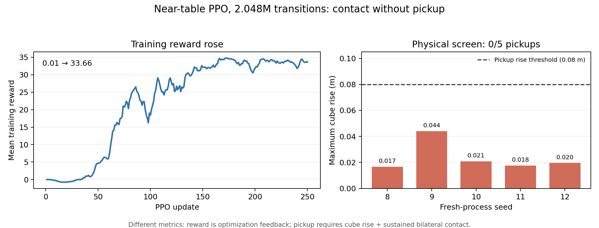
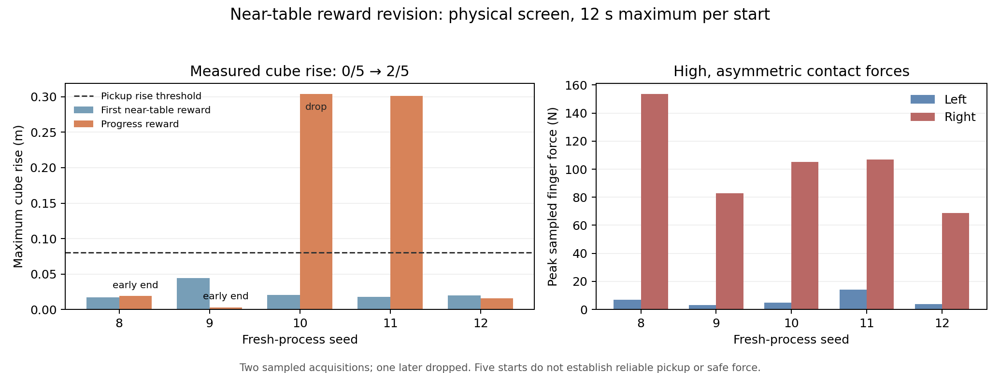

# Near-table learned-pickup curriculum — 2026-11-02

Status: the additive reset task passed its startup and reset geometry screens.
The first 2,048,000-transition learning run completed, and its five-start
physical screen found contact without pickup (0/5). The original
`FRI-Franka-Lift`, Approach, pre-grasp, scripted EEG comparison, checkpoints
and outputs remain separate. A second task ID isolates the revised reward
incentive; its five-start physical screen is now recorded below.

## Completed startup and reset gates

- Brev startup run: `outputs/isaac/near-table-startup-20261102T2245Z`, seed 8,
  4 environments, 2 updates, fresh policy, exit 0. This proves the task can
  construct and train briefly; the logged success reward was 0.
- Brev reset screen: `outputs/isaac/near-table-reset-screen-20261102T2305Z`,
  seed 8, 1 environment, no policy checkpoint. The preserved machine report is
  [`results/near_table_reset_screen_2026-11-02.json`](../results/near_table_reset_screen_2026-11-02.json).
  The cube center was z=0.2800 m on the table. Both finger joints were open at
  0.0400 m; finger body frames were 0.0166 m above cube top and 0.0400 m from
  cube center in the horizontal plane. Both initial finger contact sensors read
  0 N. A zero action moved the cube 0.00029 m and hand 0.00445 m in the first
  policy step. The 9-action, 100-policy-observation interface constructed.
- Runtime: pinned Isaac Lab `e3f7d9ff1f5d7f8280de3ece9000b7117f66bcf4`,
  Newton MJWarp, NVIDIA L4, Personal checkout source selected with explicit
  `PYTHONPATH`; near-table source SHA256
  `a4fbdf45eb36a004d5769d15b20f623900f3802cb897882469351189a762d632`.
  The executed reset script SHA256 was
  `9d8a1ec6e63388091643bea43af8fcabb0b65e587cb9e9f2b542482690850d72`.
  The reset screen checks body-frame positions and contact sensors; it is not
  a collision-mesh proof or a pickup test.
- Two-update throughput probes in fresh directories all exited 0 on the L4:
  `near-table-bench-64-20261102T2320Z`,
  `near-table-bench-128-20261102T2322Z`, and
  `near-table-bench-256-20261102T2324Z`. Their warm second rollout collection
  times were respectively 0.460, 0.512, and 0.545 s; initial compilation and
  startup dominate a two-update run. This is a capacity screen, not a
  convergence claim. The 256-environment size was selected.
- Bounded stage-1 run launched from scratch in its own
  `outputs/isaac/near-table-stage1-256x250-seed8-20261102T2250Z`
  directory: 256 environments × 32 rollout steps × 250 updates = 2,048,000
  transitions. The runner's configured checkpoint interval is 250, so the
  final model is the first intermediate physical-screen candidate. This run
  completed with exit 0 and saved `model_249.pt` (SHA256
  `50713284b5c112bce1269a2a25054c10100b115f7c1075d01f49c152ebd3895e`).
  The checkpoint and full logs remain in that ignored Brev directory.

## Stage-1 physical outcome and next incentive test

Five fresh-process 12-s playback starts (seeds 8–12) used the same task and
saved model, with the corrected PPO recorder at 120-Hz physics sampling. All
five episodes completed by timeout; every sample had valid finger contact
data and no physics gaps. Maximum cube rises were 0.0167, 0.0439, 0.0207,
0.0176, and 0.0195 m. The sampled pickup threshold is 0.08 m plus 0.1 N on
both fingers for at least 0.5 s, so the result was **0/5**. Finger contact
occurred in each episode, but maxima were roughly 102–105 N left and 43–51 N
right. Training reward rose from 0.01 to 33.66 while the training task's
success metric remained 0. The complete physical screens and source hashes
are in [`results/near_table_stage1_screen_2026-11-02.json`](../results/near_table_stage1_screen_2026-11-02.json);
the figure below is generated by `analysis/plot_near_table_stage1.py`.

The seed-8 trace shows the hand descended from z=0.380 m to as low as
z=0.340 m and remained near the table. Its maximum raw policy action magnitude
was 3.665; 803/3,240 components exceeded magnitude 1. Relative joint-action
targets were not clipped at the agent level in this run. The task rewarded
continuous good finger contact much more often than cube-to-goal progress:
final logged reward terms were about 1.885 contact versus 0.112 position
progress. This supports a contact-without-lift diagnosis; it does not prove a
unique cause. The policy is not a qualified learned table pickup, and further
updates on this reward setup are paused.

`FRI-Franka-Lift-NearTable-Progress` keeps the first task's scene, reset,
robot, nine-action interface, observations, physics, and success definition.
It separately lowers finger-to-object weight 1.0→0.2, continuous good-contact
2.0→0.1, contact-count 0.25→0, and increases the existing contact-gated
best-position-progress weight 5→25. This combined incentive test changes four
weights, so it cannot identify a single causal reward term. Its startup,
bounded training, and fresh-process physical screen were completed. The
scripted/PPO measurement-parity caveat still applies.

The progress task's resolved configuration was checked on Brev against the
first near-table task: the cube and joint reset values matched, and the four
specified reward weights changed as intended in both training and play mode.
Its 4-environment, seed-8, 2-update startup run completed with exit 0 under
`outputs/isaac/near-table-progress-startup-20261102T2310Z`. A separate
256-environment, seed-8, 250-update run then completed under
`outputs/isaac/near-table-progress-256x250-seed8-20261102T2305Z` with exit 0.
The final `model_249.pt` SHA256 is
`46f68c087111b5f713c33a63b7355f3c4c35eeaba26e4240f778667086b443d6`.
At update 249 the **training task metric** reported success rate 0.1102, mean
reward 2.52, and object-out-of-bounds termination rate 0.6498. These values
are optimization diagnostics. The separate physical screen follows.

## Progress-reward physical screen

The same saved `model_249.pt` ran in five **fresh processes**, seeds 8–12,
one episode per process, with the first rung's 12-s maximum, Newton MJWarp,
and frozen sampled lift predicate (cube rise >=0.08 m with >=0.1 N on both
fingers for >=0.5 s). All five playback processes exited 0, all episodes have
pre-action baselines and pre-reset terminal states, contact coverage was 100%,
and there were no physics-sample gaps. The recorder reported
`environment_physics_step` at 120 Hz. Raw telemetry is retained on Brev under
`outputs/isaac/near-table-progress-eval-5x12s-seed8-12-20261102T2330Z` and
in the local ignored output copy. The compact, source-hashed record is
[`results/near_table_progress_screen_2026-11-02.json`](../results/near_table_progress_screen_2026-11-02.json).
The progress training directory (46.2 MB) and all five evaluation directories
were copied to local ignored `outputs/isaac/near_table_progress_eval_local/`;
checkpoint, resolved configs, console and exit hashes match Brev. This is a
verified second copy of these new runs, not a backup claim for historical
Brev outputs.

| Seed | Duration (s) | Max rise (m) | Max left/right force (N) | Acquisition | Drop | Terminal |
|---:|---:|---:|---:|---|---:|---|
| 8 | 0.93 | 0.019 | 7.0 / 153.5 | No | 0 | Early, cube z=0.2393 m |
| 9 | 1.50 | 0.003 | 3.2 / 83.0 | No | 0 | Early, cube z=0.2381 m |
| 10 | 12.00 | 0.304 | 4.9 / 105.0 | Yes, 1.775 s | 1, at 2.50 s | Timeout |
| 11 | 12.00 | 0.302 | 14.0 / 107.0 | Yes, 1.533 s | 0 | Timeout |
| 12 | 12.00 | 0.016 | 3.7 / 68.6 | No | 0 | Timeout |

Result: **2/5 sampled physical acquisitions**, up from 0/5 in the first
near-table screen under the same fixed scene and seeds. Only **1/5 had no
recorded drop after acquisition**. Seeds 8 and 9 ended early with terminal
cube heights below the task's 0.24-m z bound, consistent with the
out-of-bounds training signal. The force maxima are highly asymmetric and
reach 153.5 N on one finger. These five starts are a diagnostic improvement,
not reliable or force-qualified pickup, full approach, or EEG-controlled
learning. Do not continue this reward variant blindly or advance the start
distance on this evidence.

Brev's Personal checkout was dirty and behind the published branch, so the
result record includes the actual imported module paths, executed source
SHA256 values, pinned Isaac Lab commit, and resolved training-config hashes.
The task and recorder contents matched the published files after normalizing
Windows CRLF to Linux LF; their raw byte hashes differ. No pull or reset was
applied to the Brev checkout or the older archive. The next experiment should
target action amplitude, gripper force asymmetry and cube-out-of-bounds
behavior, with an explicit new task/version and measured screen before more
training budget. Demonstration initialization is another candidate, but it
has not been tested for this task.

## Target-bound inference diagnostic

The saved unguarded traces show finger position targets below zero during
large one-sided force events. To test whether that command alone explained
the force, the opt-in
`FRI-Franka-Lift-NearTable-Progress-FingerGuard` task changed only the final
two absolute finger joint targets to the interval [0.02, 0.04] m after the
same nine relative actions. It reused the **existing progress checkpoint at
inference only**; no policy was trained under the guard. A one-step GPU check
with raw finger actions −1/−1 verified both commanded targets were 0.02 m.
The robot/cube reset and reward weights matched the unguarded progress task.

Two previously observed seeds were chosen deliberately: seed 8 had failed
early, while seed 11 had acquired without a recorded drop. Both guarded
episodes had pre-action baselines, full contact coverage and pre-reset
terminal states. The [compact paired diagnostic](../results/near_table_finger_guard_diagnostic_2026-11-02.json)
contains exact run/source hashes and the retained raw directories.

| Seed | Unguarded max rise / right peak | Guarded max rise / right peak | Guarded result |
|---:|---:|---:|---|
| 8 | 0.019 m / 153.5 N | 0.017 m / 203.0 N | Early end at 0.93 s; no acquisition |
| 11 | 0.302 m / 107.0 N | 0.008 m / 115.5 N | Early end at 5.57 s; no acquisition |

The guard eliminated negative finger targets in both actual playbacks but did
not reduce the selected force failures or preserve the successful behavior.
Stop this guard as a candidate fix. This is a **two-case selected diagnostic**,
not a five-start success estimate or evidence that bounded targets are useless
when a policy is trained with them. Right-finger contact began even while the
finger joints were near the open position; arm motion, collision geometry and
actuator/contact settings need a focused source-and-trace check before a new
training budget. The edited action path and this diagnostic remain separate
from both learned checkpoints and the frozen scripted reference.

The [verified early-contact trace](../results/near_table_contact_trace_2026-11-02.json)
narrows the next question. On seeds 8 and 11, the first right-finger force above
1 N appeared within 0.05–0.083 s, with both actual finger joints still near
their 0.04 m open position. It appeared in the bounded-target run as well.
At that instant the cube center was about 5–6 mm to one side and 12–16 mm
to the other side of the hand-body center, and about 92 mm below it. The
hand-body pose is not a fingertip pose, so these coordinates do not prove a
particular collision. Both force peaks occurred before 0.5 s.

**Next bounded diagnostic:** run the unchanged progress actor from the same
two fixed resets for at most 1 s with an opt-in task that commands both finger
joints to stay at the 0.04 m open target while preserving the actor's seven arm
actions, scene, physics, and telemetry. Use new output directories; verify
the actual target on every physics sample. Compare first right contact time,
peak force, hand/cube relative pose, and cube displacement against these
traces. If right contact remains with open targets, inspect the arm path,
fingertip collision geometry and actuator/contact configuration before more
PPO. If it disappears, investigate gripper closing and contact timing with a
task version trained under that action mapping. This is a contact mechanism
check, not a pickup success screen; neither outcome alone licenses training
or a reliable-pickup claim.

## Why this rung exists

The project PPO checkpoint learned to lift a cube already between its fingers
(5/5 in-hand starts) but failed measured table pickup. The completed 100-update
Approach fine-tune spent 204,800 transitions from a ready arm/table cube reset
and still yielded 0/5 lifts. The next learning problem is acquisition, not
retaining a grasp the reset has already supplied.

`FRI-Franka-Lift-NearTable` inherits the Approach task's robot, free cube,
observations, 0.1-scale relative joint actions, reward terms, and RSL-RL PPO
agent. It changes only the robot's default reset arm pose. The cube remains
table-supported at the existing fixed location, and both fingers start open.
The arm pose is the measured scripted controller's pre-contact `grasp` joint
waypoint, recorded in the corrected positive control's log. In that reference,
the fingertip plane was about 0.0166 m above the cube top and the open fingers
were outside its sides. Task reset validation must confirm the same clearance
in the manager-based RL environment; a saved waypoint is a proposal, not proof
of a valid reset in a different execution path.

## Bounded startup gate before a long run

1. Launch from the Personal checkout's source via an explicit `PYTHONPATH` or
   verified editable install. The Brev venv's old archive import must not
   silently substitute an older task module. Record import paths, pinned
   Isaac Lab commit, source hashes, resolved task/agent configs and seed.
2. Run a new-directory 4-environment, 2-update smoke from scratch. Inspect
   reset bank creation, actual cube/hand/finger poses, open width, zero initial
   bilateral contact, table support, first physics-step continuity, and
   action/observation dimensions. Completed above; preserve failed attempts
   and original checkpoints.
3. If valid, benchmark 64/128/256 environments briefly on the L4 to select
   a sustainable headless rollout size. Do not assume NVIDIA's example
   4,096-environment configuration fits this task or hardware.
4. Freeze an initial learning budget before launch: for example, 256
   environments × 32 rollout steps × 500 updates = 4,096,000 transitions,
   with checkpoint and measured five-episode table screens every 100 updates.
   This is a first rung, not the final long campaign. Stop or redesign if
   measured contact and lift do not develop; do not extend merely because
   mean reward increases. A larger budget and farther-start transfer require
   a new explicit experiment record.

The first rung is deliberately fixed geometry. It can establish that a policy
learns contact/lift from a table-supported cube near the gripper. It cannot
establish full approach from the ready pose or spatial generalization.
Subsequent rungs must move the open gripper farther away and add frozen,
validated reset variation before final fixed-scene and perturbed evaluation.

## Measurements and interpretation

For each physical screen, save initial pose before action, first physics
sample, actual finger-to-cube forces, arm/finger targets, terminal state before
reset, drops, incomplete episodes, and all training/optimizer/normalizer
provenance. Apply the existing sampled predicate: cube rise >=0.08 m and each
finger force >=0.1 N spanning >=0.5 s. Use one episode per process if reset
continuity is unverified; report early terminations. The current project PPO
recorder's eager Newton actuation must be disclosed, and a parity check is
needed before claiming a controlled scripted-versus-PPO result.

No EEG is used for this stage. Continuous enable/HOLD/resume is tested only
after a learned robot-only table policy qualifies. The frozen scripted
comparison remains a reference experiment.
