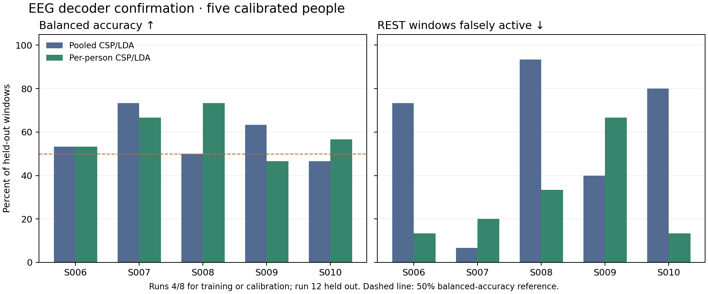
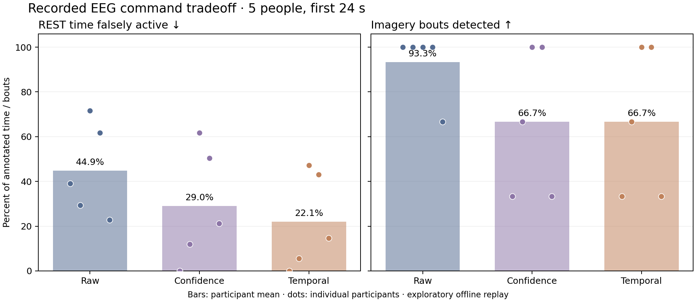
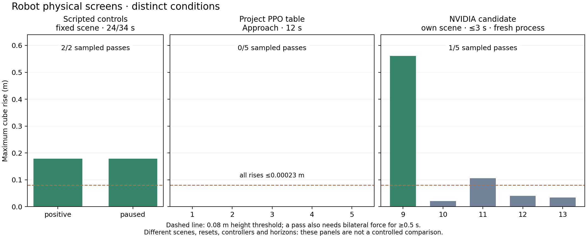

# Project check-in — 2026-11-02

## Where we are

The project has a working **research pipeline in pieces**: public EEG can be
decoded and replayed causally into HOLD/GRASP_LIFT requests; a scripted Franka
controller can lift a free table-supported cube and pause without target drift in a fixed
simulation scene; PPO and an external pretrained policy have been physically
screened. The central end-to-end deliverable is **not complete**. No learned
controller has demonstrated reliable table pickup in this project, and recorded
EEG has not controlled a qualified learned controller. There is no live EEG,
hardware, or clinical result.

The design decision is to keep robot learning as a required deliverable, retain
the scripted controller as a reference, and use continuous enable/HOLD/resume
for the first learned EEG interface. The EEG labels are instructed rest versus
left/right fist imagery (combined as hand imagery); they do not identify a
specific grasp motion.

## Evidence by workstream

| Workstream | What is demonstrated | What it does not establish |
|---|---|---|
| EEG decoder | Frozen development selection chose per-person CSP/LDA. On five later participants (S006–S010), with each person's runs 4/8 used for calibration and run 12 held out, balanced accuracy was **59.33%** over 150 windows; rest-window false activation was **29.33%**. | This is calibrated within-person, offline and cue-based. It is not performance on an uncalibrated new person, live intent, or a grasp label. The earlier 49.33% pooled CSP and higher per-person exploratory results were from already inspected S001–S005 recordings. |
| Causal command replay | In the five-person first-24-s exploratory replay, temporal gating reduced mean annotated-rest active time from **44.9% raw to 22.1%**, while mean imagery-bout detection fell from **93.3% to 66.7%**. | A gate trades coverage for fewer false activations. These are command-trace measures, not physical lifts or proof that filtering improves task completion. Probabilities are uncalibrated. |
| Scripted robot reference | A fixed-scene waypoint controller lifted a free cube about **0.179 m** with sustained bilateral contact. After HOLD repair and a common 2-s pre-roll, always-HOLD, uninterrupted lift, and paused/resumed lift controls passed their frozen checks. | Scripted motion is not robot learning or a multiple-scene reliability result. |
| Recorded EEG → scripted robot | A historical 24-s five-person run reported raw 1/5 lifts and filtered 0/5, but its always-HOLD control drifted about 0.141 m, invalidating the physical comparison. One corrected 120-s S006 temporal case had complete trace alignment, only **0.692 s** of enable time, and no motion/lift. The corrected five-person, three-gate 120-s batch was stopped incomplete. | No valid paired physical effect of EEG filtering has been established. The incomplete batch must not be treated as a result. |
| Project PPO | The original pre-grasp checkpoint lifted **5/5** from privileged in-hand starts but **0/5** from table starts. A bounded Approach fine-tune from that checkpoint completed **100 additional PPO updates**, 64 environments × 32 steps × 100 = **204,800 transitions**, with optimizer and normalizer restoration verified. Five measured 12-s table episodes with the final checkpoint yielded **0/5** pickups; bilateral contact appeared in one. | Pre-grasp lifting, reward, update count, and exit code do not prove table pickup. The PPO physics-step recorder used eager Newton actuation; parity with the earlier fused path is unproven, so this is not a clean scripted-versus-PPO comparison. |
| NVIDIA pretrained candidate | An official `model_399.pt` Franka Cube policy was integrated separately without replacing project code or training weights. The first in-process five-episode screen had four invalid starts: reset writes disappeared on the first physics step. Five **independent fresh-process** starts passed the continuity check; **1/5** met the sampled sustained two-finger lift criterion. Three episodes ended early under the native task's termination flag. | It is a different scene, reset distribution, assistance logic, and up-to-3-s horizon. It does not transfer directly into project PPO, demonstrate reliability, or justify comparison with the project's 12-s 0/5. Finger forces exceeded 100 N and native joint clamps fired often. |

## Graphs from saved results

The charts are descriptive. Dots in the EEG command chart are individual
participants, so its mean bars do not hide the variation. The robot panels
have different scenes, controllers, resets and horizons; their pass counts
must not be read as a controlled comparison.

Figure data, exact input SHA256 hashes and physical validity flags are tracked
in `results/project_checkin_plot_data_2026-11-02.json`. Regenerate PNG
figures from that compact file with `python analysis/plot_project_checkin.py`.
Use `--collect` only when the ignored raw outputs have been restored locally;
it checks that the corrected EEG physical batch is still marked incomplete.

These figures show where the pipeline stops: the decoder and request stream
have offline measurements, the scripted robot has valid controls, and the
learned table-pickup skill has only small robot-only screens. There is no
validated EEG-to-learned-policy outcome to graph yet. Training reward curves
would show optimization behavior, not physical pickup; they are not substituted
for these sampled position/contact outcomes.

## What has changed in the engineering workflow

- Source of record is `Mohnclizzy/FRI-BCI-ML-RL-Decoder-Personal`, branch
  `codex/robot-learning-design`. `origin` points there. Mario's older
  `personal-fork` is historical; `upstream` is Angel's repository and is not
  modified. This check-in is based on the branch after commit `dcddf4a`.
- Brev `compact-green-alligator` has an NVIDIA L4 and Isaac Lab at
  `/home/ubuntu/IsaacLab-fri`, commit
  `e3f7d9ff1f5d7f8280de3ece9000b7117f66bcf4`. The installed editable
  project still imports from the older `/home/ubuntu/FRI-project-8b9db42`
  archive; the later handoff records the exact imported source for its run.
  That archive, source checkpoint and outputs were preserved. Do not assume a
  fresh Personal checkout is what Brev imports without checking each launch.
- Git tracks code, protocols and compact result records. Large EEG data,
  checkpoints and physics traces live in ignored `data/` and `outputs/`.
  The private release in `docs/ARTIFACT_HANDOFF.md` is an earlier snapshot;
  it does **not** contain every later PPO/candidate run. New NVIDIA candidate
  raw runs have verified local/remote compressed copies. Backup of all
  historical Brev outputs remains unverified.
- The Brev CLI worker was left idle after the bounded candidate work. A read-only
  check on 2026-11-02 found the L4 at 0% utilization with no compute process.
  A separate account
  should read this report and the cited run records from Git rather than rely
  on chat history or a Jupyter terminal view.

## Current decision and next gates

1. **Audit the NVIDIA port before more GPU spending.** Compare exact native
   checkpoint preprocessing, observation order/normalization, action scaling,
   reset writes, asset transforms, actuator/contact settings and interventions
   against the compatibility port and its saved traces. Explain the reset-state
   loss and high forces. This is a bounded source-and-trace review, not another
   training run. Keep the candidate isolated.
2. **Finish the corrected scripted EEG reference** from the frozen 120-s
   protocol, with valid HOLD/positive controls and all 15 paired episodes.
   Preserve the interrupted run as incomplete. Report physical completion,
   rest motion, command coverage and delays separately.
3. **Choose and freeze the next learned table-pickup experiment** after the
   port audit: either validate a faithful pretrained condition or implement
   the near-table approach curriculum/demonstration-assisted PPO path in
   `docs/ROBOT_LEARNING_DESIGN_2026-11-02.md`. Specify reset ranges, compute
   budget, independent seeds, and physical stop criteria before launch. A
   five-episode screen is diagnostic; the design's proposed readiness gate is
   at least 18/20 fixed-scene pickups plus separate perturbation and seed tests.
4. **Only after a learned policy qualifies**, implement its continuous
   enable/HOLD/resume adapter. Test always-HOLD and pauses during approach,
   closure and loaded lift before connecting recorded EEG. Then compare EEG
   gates on the same frozen policy, inputs, reset manifests and measurement path.

## Records that control interpretation

- EEG: `docs/decoder_comparison_2026-11-01.md`,
  `docs/multi_person_replay_2026-11-02.md`,
  `docs/stopping_point_2026-11-02.md`,
  `docs/completion_protocol_2026-11-02.md`.
- Project PPO: `docs/ppo_lift_evaluation_2026-11-02.md`,
  `docs/BREV_HANDOFF_2026-11-02.md`, `results/ppo_approach_*2026-11-02.*`.
- Pretrained policy: `docs/POLICY_REUSE_AUDIT_2026-11-02.md`,
  `docs/NVIDIA_CANDIDATE_INTEGRATION_2026-11-02.md`,
  `docs/NVIDIA_CANDIDATE_RESET_DIAGNOSTIC_2026-11-02.md`,
  `results/nvidia_candidate_2026-11-02/`.

Older `START_HERE.md`, `PROJECT_HISTORY.md`, and some early run documents are
historical snapshots. Where they say the Approach fine-tune has not run, the
corrected EEG batch is complete, or the original 24-s physical comparison is
valid, use the dated later records above and this check-in instead. No
population-level, hardware-safety, or learned EEG-to-robot claim follows from
the current evidence.
