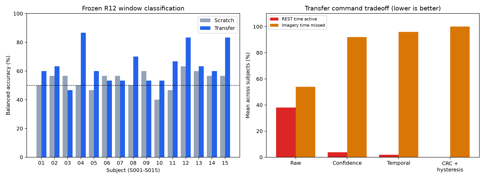

# Frozen EEGNet experiment results - 2026-11-11

Completed source pretraining, adaptation, calibration, and user-authorized final R12 evaluation. No retuning after evaluation.

Transfer mean balanced accuracy: **63.78%**, versus **53.78%** for scratch; paired mean difference **10.00 percentage points** across 15 subjects.
Transfer was higher for 11 subjects, tied for 0, and lower for 4.

**Main limitation: CRC+hysteresis emitted no commands for all 15 subjects in both model conditions. Zero false activations came with 100% missed imagery. This configuration did not provide usable command delivery.**

| Model | Gate | REST time active | Imagery time missed | Silent subjects |
|---|---|---:|---:|---:|
| transfer | raw | 38.02% | 53.91% | 0/15 |
| transfer | confidence | 3.70% | 91.95% | 1/15 |
| transfer | temporal | 1.86% | 95.90% | 4/15 |
| transfer | crc_hysteresis | 0.00% | 100.00% | 15/15 |
| scratch | raw | 47.85% | 49.27% | 0/15 |
| scratch | confidence | 0.00% | 100.00% | 15/15 |
| scratch | temporal | 0.00% | 100.00% | 15/15 |
| scratch | crc_hysteresis | 0.00% | 100.00% | 15/15 |

Fractions are arithmetic means of subject-level time fractions, not independent-window estimates. Classification uses 30 annotation windows per subject (15 REST, 15 imagery). Command metrics use continuous causal replay and are distinct from window accuracy.

| Subject | Scratch balanced accuracy | Transfer balanced accuracy | Difference (points) |
|---|---:|---:|---:|
| S001 | 50.00% | 60.00% | +10.00 |
| S002 | 56.67% | 63.33% | +6.67 |
| S003 | 56.67% | 46.67% | -10.00 |
| S004 | 50.00% | 86.67% | +36.67 |
| S005 | 46.67% | 60.00% | +13.33 |
| S006 | 56.67% | 53.33% | -3.33 |
| S007 | 56.67% | 53.33% | -3.33 |
| S008 | 50.00% | 70.00% | +20.00 |
| S009 | 60.00% | 53.33% | -6.67 |
| S010 | 40.00% | 53.33% | +13.33 |
| S011 | 46.67% | 66.67% | +20.00 |
| S012 | 63.33% | 83.33% | +20.00 |
| S013 | 60.00% | 63.33% | +3.33 |
| S014 | 56.67% | 60.00% | +3.33 |
| S015 | 56.67% | 83.33% | +26.67 |

Protocol and verification

- Unchanged configs/gpu_research.json, code commit 6f910c4. CPU execution. Source: 89 subjects, 267 recordings, 5,340 training windows and 2,670 validation windows.
- Pretraining stopped at epoch 19 after eight non-improving epochs. Best source checkpoint: epoch 11, validation loss 0.686518.
- Each target model used 25 epochs on R04. Alignment used R04; threshold calibration used R08. Only then was R12 evaluated, after explicit user authorization.
- CPU test suite passed with local simulation/src import path configured in pytest.ini and conftest.py.
- All 155 pretrain, adaptation, calibration, and evaluation hashes verified; all 30-window trial lists verified as R12. Frozen hashes are in artifact_hashes.json, with paths relative to outputs/local_scratch_2026-11-11.

Interpretation and remaining work

Previously inspected S001-S010 R12 recordings and the November 11 evaluation of S011-S015 R12 mean all 15 target R12 recordings are now inspected; S011-S015 can no longer be described as an unopened confirmation cohort. A single seed and 15 participants do not establish robust superiority.

The CRC candidates explicitly claim no prospective risk guarantee. Offline inference latency is simulated as zero. Robot motion, task success, retention, and physical safety were not measured in this experiment. Existing robot experiments use other decoder outputs.

The next development task is to investigate command sensitivity using training/development data, then freeze a new protocol before testing. Do not tune thresholds or persistence against these R12 outcomes. Raw gating is active but has substantial false activation; stricter gates substantially miss imagery.

Artifacts

Local raw artifact root: outputs/local_scratch_2026-11-11. Each scratch/Sxxx and transfer/Sxxx directory contains model.pt, adaptation.json, calibration.json, evaluation/metrics.json, and evaluation/SxxxR12-decisions.jsonl. Large raw artifacts are gitignored and archived with SHA-256 verification. This report package contains aggregate and per-subject metrics, configuration, source training history, plots and checksums.
