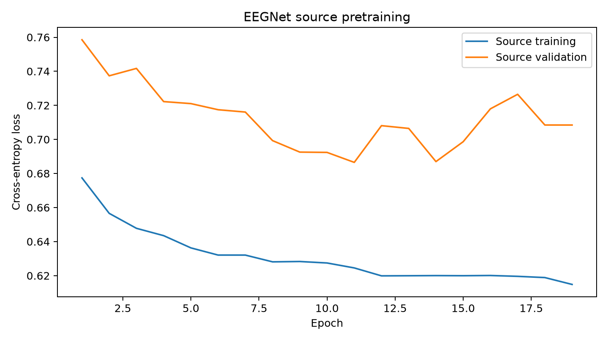

# EEGNet training and calibration - 2026-11-11

Configuration: configs/gpu_research.json, unchanged. Source code: 6f910c4. Local CPU execution.
Source subjects: 89; target subjects: S001-S015. Source R04/R08 train, source R12 validation. Target R04 adaptation, target R08 calibration. Target R12 was subsequently evaluated after explicit authorization; see [final results](evaluation_summary.md).

Pretraining epochs recorded: 19.
Best source-validation loss: 0.686518 at epoch 11. This is model-selection evidence, not target test performance.

| Subject | Model | Adaptation epochs | Threshold | REST episodes | Calibration status |
|---|---|---:|---:|---:|---|
| S001 | scratch | 25 | 0.515 | 15 | empirical_crc_candidate |
| S002 | scratch | 25 | 0.530 | 15 | empirical_crc_candidate |
| S003 | scratch | 25 | 0.525 | 15 | empirical_crc_candidate |
| S004 | scratch | 25 | 0.540 | 15 | empirical_crc_candidate |
| S005 | scratch | 25 | 0.510 | 15 | empirical_crc_candidate |
| S006 | scratch | 25 | 0.530 | 15 | empirical_crc_candidate |
| S007 | scratch | 25 | 0.540 | 15 | empirical_crc_candidate |
| S008 | scratch | 25 | 0.505 | 15 | empirical_crc_candidate |
| S009 | scratch | 25 | 0.535 | 15 | empirical_crc_candidate |
| S010 | scratch | 25 | 0.520 | 15 | empirical_crc_candidate |
| S011 | scratch | 25 | 0.535 | 15 | empirical_crc_candidate |
| S012 | scratch | 25 | 0.535 | 15 | empirical_crc_candidate |
| S013 | scratch | 25 | 0.520 | 15 | empirical_crc_candidate |
| S014 | scratch | 25 | 0.540 | 15 | empirical_crc_candidate |
| S015 | scratch | 25 | 0.540 | 15 | empirical_crc_candidate |
| S001 | transfer | 25 | 0.810 | 15 | empirical_crc_candidate |
| S002 | transfer | 25 | 0.830 | 15 | empirical_crc_candidate |
| S003 | transfer | 25 | 0.695 | 15 | empirical_crc_candidate |
| S004 | transfer | 25 | 0.765 | 15 | empirical_crc_candidate |
| S005 | transfer | 25 | 0.770 | 15 | empirical_crc_candidate |
| S006 | transfer | 25 | 0.700 | 15 | empirical_crc_candidate |
| S007 | transfer | 25 | 0.810 | 15 | empirical_crc_candidate |
| S008 | transfer | 25 | 0.690 | 15 | empirical_crc_candidate |
| S009 | transfer | 25 | 0.755 | 15 | empirical_crc_candidate |
| S010 | transfer | 25 | 0.720 | 15 | empirical_crc_candidate |
| S011 | transfer | 25 | 0.685 | 15 | empirical_crc_candidate |
| S012 | transfer | 25 | 0.755 | 15 | empirical_crc_candidate |
| S013 | transfer | 25 | 0.850 | 15 | empirical_crc_candidate |
| S014 | transfer | 25 | 0.790 | 15 | empirical_crc_candidate |
| S015 | transfer | 25 | 0.870 | 15 | empirical_crc_candidate |

Calibration candidates have guarantee_claimed=false. They are not held-out accuracy or physical-safety evidence.

Validation: CPU test suite passes via root pytest.ini/conftest.py local import path configuration (preventing the shared virtual environment from importing simulation code from an older checkout). All 155 model, calibration, pretraining, and evaluation hashes verified.

All target R12 recordings (S001-S015) have now been inspected: S001-S010 in earlier project phases and S011-S015 in the authorized November 11, 2026 evaluation. None may be described as an unopened confirmation cohort in subsequent analyses.

Raw data, cached arrays, models and logs are local under outputs/local_scratch_2026-11-11. Four CPU threads were used for source pretraining; two for the later scratch controls.

Local artifact root: `outputs/local_scratch_2026-11-11/`. Checksum keys in `artifact_hashes.json` (155 entries) are relative to that root.
