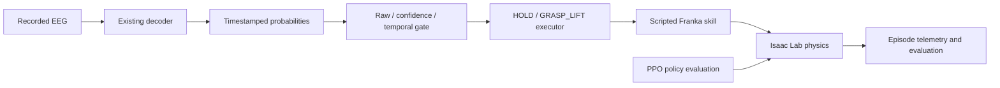

# Isaac Lab project scaffold

This is Mario's Isaac Lab simulation architecture, separate from the earlier
PyBullet prototype. It now includes a measured recorded-EEG-to-scripted-Franka
pilot and a separately evaluated PPO policy. It is **not a live or physical BCI
controller**; all robot execution described here is simulated.

## Architecture



Ground-truth EEG labels belong to the evaluator, not the actor or command
filter. Paired human motion, if adopted after dataset inspection, belongs to a
separate retargeting/demonstration pipeline. It does not establish EEG for novel
robot movements. No dataset or synthetic EEG generator is silently assumed.

## What works locally, and what requires Brev

| Component | Status |
|---|---|
| Offline decoder-export adapter | Implemented; each trial stays a separate episode |
| Causal full-recording decoder replay | Implemented for current model/PhysioNet EDF; logical time, no annotation input |
| Raw/confidence/temporal trace comparison | Implemented on equal continuous estimates; command metrics only |
| Confidence/persistence command filter | Implemented; simulator-independent tests |
| Measured episode-outcome summary | Implemented; requires actual telemetry input |
| Cloud command planner and runtime checks | Implemented; default prints plan only |
| Isaac Lab external Franka lift configuration | L4/Newton task startup and bounded simulation evaluations verified on Brev |
| PPO pre-grasp checkpoint | Measured free-cube lift in 5/5 12 s episodes from in-hand resets; not a table pickup |
| PPO table transfer | 64-env, 100-iteration transfer and checkpoint playback completed; 0/5 table lifts, no finger contact; hand moved away from cube |
| Near-table PPO rungs | First 256-env, 250-update reward: 0/5 physical pickups despite contact. Separately versioned progress reward: 2/5 sampled acquisitions in fresh-process 12 s screens, with one drop, two early ends and high asymmetric force; not a qualified pickup policy. See [curriculum and screens](../docs/NEAR_TABLE_CURRICULUM_2026-11-02.md). |
| Recorded EEG gate commands affecting the scripted Franka lift | First S001R12 replay pilot complete for raw, confidence, and temporal gates; see [pilot results](../docs/end_to_end_pilot_2026-11-02.md) |
| Scripted-skill HOLD/resume and simulator telemetry | Repaired locally in `scripts/controlled_lift.py`: HOLD preserves the last commanded arm and finger targets across pauses; completion is absorbing; per-step telemetry is tested. All three corrected physical controls passed after the documented 2 s initialization; see ../docs/stopping_point_2026-11-02.md |
| PPO behavior under EEG commands | Not connected; the end-to-end filtering pilot uses the scripted skill because table-transfer PPO has no measured lift |
| Five-person EEG command replay preflight | Complete for S006–S010 over the same 24 s horizon; filters reduce rest activation but miss more imagery bouts; exploratory only, see [cohort replay](../docs/multi_person_replay_2026-11-02.md) |
| Historical 24 s matched five-person Franka run | Preserved as exploratory debugging evidence only. Its physical HOLD control was invalid, so its lift counts do not support comparison claims. Corrected controls passed; one 120 s EEG case was validated, and the expanded matched rerun remains incomplete after user-requested stop; see the [completion protocol](../docs/completion_protocol_2026-11-02.md) |

The boundaries above are deliberate: a command trace is not robot execution,
and a successful process exit is not evidence of a successful grasp. A playback
counts as a physical evaluation only when simulator state and contacts are logged.

### Recorded EEG to Franka scripted-skill pilot

The first bounded end-to-end pilot has been run and its telemetry preserved.
After creating a causal estimate trace and a three-gate decision trace locally,
copy the decisions JSONL to the pinned Brev runtime and call
`simulation/scripts/controlled_lift.py` with `--decisions PATH` and
`--condition raw|confidence|temporal`. With `--joint-waypoints`, simulated
skill time advances only while the selected gate requests `GRASP_LIFT`; during
`HOLD`, the last commanded arm and finger targets remain latched, including
through pauses. This is the scripted Franka baseline; it does
not execute the PPO policy. Use a fresh output path for each condition. The
pilot and its interpretation limits are in
[`docs/end_to_end_pilot_2026-11-02.md`](../docs/end_to_end_pilot_2026-11-02.md).
Matched controls use `--condition always-hold` (24 s; no decision trace; must
not lift and must meet fixed motion/target tolerances), `--condition
scripted-positive` (24 s; must lift and complete), and `--condition
scripted-pause` (34 s; must lift and complete across a pause). Both positive
controls must pass before EEG condition outcomes can be interpreted. Local
executor/evaluator tests pass; all three corrected GPU controls passed; see the stopping-point record.

## Local checks (no Isaac, CUDA, or EEG download required)

From the repository root:

```powershell
python -m pip install -e simulation --no-deps
python -m unittest discover -s simulation/tests -v
python -m fri_bci_sim.cli train --isaaclab-root C:/path/to/IsaacLab --run-dir outputs/isaac/smoke
```

The third command prints an argv list; it does not start training. Pure command
logic supports Python3.12+; the pinned cloud simulator uses Python3.12.

With Angel's existing export:

```powershell
python -m fri_bci_sim.cli replay --predictions outputs/baseline/test_predictions.json --output outputs/isaac/requests.jsonl
```

This is isolated-trial replay with confidence-only acceptance. It cannot measure
command-switch rates, continuous latency or temporal persistence. Each current
prediction has a unique trial ID; never smooth across unrelated trials to invent
a continuous command stream. Use the full-recording adapter below for repeated
estimates within the same recording.
The example threshold0.7 is a configurable baseline, not a calibrated probability
guarantee. Select thresholds and persistence on training/validation data.

## Continuous replay and command comparisons

Install the existing EEG requirements in the same CPU environment (for example,
the root `requirements-lock.txt`), then install this package with `--no-deps`.
Use a trusted, locally trained `model.joblib` from the existing decoder.

```powershell
python -m fri_bci_sim.cli decode-replay --artifact outputs/baseline/model.joblib --edf PATH_TO_S001R12.edf --output outputs/isaac/continuous.jsonl
python -m fri_bci_sim.cli compare-commands --trace outputs/isaac/continuous.jsonl --output outputs/isaac/decisions.jsonl
```

This processes the full recording, including transitions, with the trained
reference/filter and carried SOS state. No annotations or cue boundaries enter
the decoder. Each window is available only after its containing input chunk;
the manifest records model/recording hashes and timing settings. Replay runs in
logical recording time, not paced wall-clock time. Measured classifier runtime
is reported separately; it is not automatically added to simulated delay. Use
`--decode-delay-s` for a declared delay experiment.

The command comparison applies all three filters to exactly the same estimates.
Its switch/active-decision counts are not grasp success, false-activation rates,
or latency relative to actual intentions. The executor and an annotation-based
timeline evaluator are implemented, but the current end-to-end evidence covers
one exploratory recording. The filter watchdog must be called by the
executor's own clock if samples stop arriving.

See the [research protocol and readiness gates](../docs/research_protocol.md).
The current operating parameters are illustrative, not selected from held-out
data. Tests of streaming require the existing NumPy/SciPy EEG dependencies.

## Robot-learning task

`FRI-Franka-Lift` inherits the pinned upstream Franka scene, contact model,
relative-joint-position actions, robot/object observations, rewards and RSL-RL
PPO configuration. The policy learns low-level actions; this project creates no
fixed cube-to-gripper attachment. Object geometry and robot state are simulation
observations, not predictions inferred from EEG.

The upstream task proposes aligned pre-grasps with probability0.75. We override
that to0 for both training and play, so the baseline is table-only. This makes
learning harder; no performance is promised. The fixed table task also disables
the listed material/dynamics randomization and curriculum; inspect the resolved
config for each run. Different seeds alone do not create cube-position
generalization when the reset geometry is fixed.

`FRI-Franka-Lift-NearTable` is an additive first curriculum rung: the cube stays
on the table and the open gripper starts near the validated scripted grasp
waypoint. It keeps the Approach observation/action/reward interface. This is
only a proposed training reset until its exact pose, clearance, physics-step
continuity and contact are checked in the pinned simulator. See the
[near-table protocol](../docs/NEAR_TABLE_CURRICULUM_2026-11-02.md).

### Opt-in physical lift curriculum

`FRI-Franka-Lift-Pregrasp` is an easier first stage. It uses the same 5 cm free
cube, Franka scene, relative joint actions, observation groups, rewards, and
RSL-RL PPO configuration as `FRI-Franka-Lift`. The pinned upstream
`reset_to_grasp` event places the cube between opened fingers at every pre-grasp
reset, with a fixed 0.75 m world-height goal. Collision-clearance checks still
reject invalid starts. The cube has full gravity and contact physics; there is
no grasp attachment. These are privileged in-hand training starts, **not**
table-pickup episodes. The second stage loads the resulting checkpoint into
`FRI-Franka-Lift` with table-only resets and its lower pickup goal. The first
stage does not establish an ability to approach or acquire an object from the
table, and a checkpoint load alone does not establish transfer.

The curriculum launcher prints plans by default. Use a new run directory for
every launch. On the pinned Isaac Lab runtime, first inspect task startup,
single-cube spawn, finger/object clearance, contacts, full gravity, target
height, reset-bank fill, reward terms, and a saved/reloaded checkpoint with a
two-iteration smoke. Only then decide whether a longer pre-grasp pilot is
justified. Keep the stage 1 checkpoint's exact path for the table transfer:

```bash
"$ISAACLAB_ROOT/.venv/bin/python" -m fri_bci_sim.curriculum \
  --isaaclab-root "$ISAACLAB_ROOT" --stage pregrasp --num-envs 16 \
  --seed 7 --iterations 2 --run-dir "$FRI_REPO/outputs/isaac/pregrasp-smoke-001"
# Inspect the plan, then repeat with --execute after startup checks.

"$ISAACLAB_ROOT/.venv/bin/python" -m fri_bci_sim.curriculum \
  --isaaclab-root "$ISAACLAB_ROOT" --stage table --num-envs 16 \
  --seed 8 --iterations 2 --checkpoint /absolute/path/to/pregrasp/model_1.pt \
  --run-dir "$FRI_REPO/outputs/isaac/table-transfer-smoke-001"
```

The table stage requires an explicit file path; the launcher passes it to the
Isaac Lab 3.0 unified trainer's `--checkpoint` argument. Inspect the new run's
resolved environment and agent configs and verify that model loading succeeded.
The measured five-episode pre-grasp result and table-transfer failure are in
[`docs/ppo_lift_evaluation_2026-11-02.md`](../docs/ppo_lift_evaluation_2026-11-02.md).
The current trainer restores optimizer state by default. The first table
checkpoint did not lift; its resolved config and playback support a targeted
approach/contact reward experiment. `FRI-Franka-Lift-Approach` keeps the table
baseline's action and observation dimensions, but changes reach/contact reward
weights. Use the same pre-grasp checkpoint to preserve initialization:

```bash
"$ISAACLAB_ROOT/.venv/bin/python" -m fri_bci_sim.curriculum \
  --isaaclab-root "$ISAACLAB_ROOT" --stage table-approach --num-envs 16 \
  --seed 8 --iterations 2 --checkpoint /absolute/path/to/pregrasp/model_99.pt \
  --run-dir "$FRI_REPO/outputs/isaac/table-approach-smoke-001"
```

Inspect the resolved reward weights, checkpoint load, cube/hand distance,
finger contact and physical lift telemetry before increasing the run. A changed
reward is a hypothesis to test, not evidence of success. Never use pre-grasp
starts in the table-pickup numerator or EEG-filter comparison.

## Command and telemetry contracts

`Estimate` contains only source, episode, window-end/availability timestamps,
and REST/HAND_IMAGERY probabilities. `Request` maps accepted hand imagery to
`grasp_lift`; other cases hold. This is a declared mapping, not a claim that the
dataset contains a distinct grasp-imagery label. The filter rejects future,
stale, duplicate and out-of-order evidence and resets at episode/source changes.

The executor treats HOLD as maintaining the last commanded arm/finger targets,
including an existing grasp; measured physical drift does not recapture a new
target. It keeps simulator time separate from decoder timestamps and logs
requests, transitions, targets, and state. This integration is simulator replay,
not live EEG; `launch.json` says `eeg_connected:false`.

The future simulator recorder must produce one JSON object per completed episode:

```json
{"episode":"test-001","requested":"grasp_lift","success":false,"unintended_motion":false,"dropped":false,"duration_s":8.0}
```

Flags must be computed from physical state over a declared evaluation horizon,
not copied from command acceptance or positive reward. Define success using a
lift-height/target tolerance sustained for a fixed dwell, drops after acquisition,
and motion during instructed hold. Specify tolerances before evaluating. The
`requested` behavior is the true evaluation request, not necessarily the decoded
command. Record trial IDs and split/scene provenance separately.

```powershell
python -m fri_bci_sim.cli score --outcomes outputs/isaac/measured_episodes.jsonl
```

Missing classes produce a null balanced score. An always-hold control must not
look good by omitting grasp episodes. Comparisons should include correct
scripted requests, raw predictions, confidence-only and temporal acceptance
(once continuous replay exists), plus always-hold and EEG-shuffled controls.

## Next cloud milestones

1. Run corrected always-HOLD, scripted-positive, and scripted-pause controls on
   the pinned GPU runtime. Stop if any fixed physical/target tolerance or
   completion check fails. Then validate one EEG replay and run the frozen
   120 s matched S006–S010 comparison on the same dataset/traces/scenes. The
   historical 24 s physical run is invalid for HOLD comparison because its
   HOLD implementation was flawed; preserve it as historical exploratory
   evidence only. Do not add a second dataset.
2. If PPO remains in the comparison, inspect its table goal/object coordinate
   observations and approach/contact reward shaping before spending more GPU time.
   The current table-transfer failure is a measured result, not evidence that the
   reset scene itself is unreachable.
3. Finish the study report and Isaac Lab demonstration. Keep the EEG input as
   recorded replay, score annotations only after decoding, and state clearly that
   the command vocabulary maps hand imagery to a grasp primitive rather than
   decoding a specific grasp intention.

## Sources and runtime pin

- Isaac Lab tag `v3.0.0`, source commit
  `e3f7d9ff1f5d7f8280de3ece9000b7117f66bcf4`.
- [Upstream external-project template](https://github.com/isaac-sim/IsaacLab/blob/v3.0.0/tools/template/templates/external/pyproject.toml.jinja)
- [Upstream Franka configuration and reset semantics](https://github.com/isaac-sim/IsaacLab/blob/v3.0.0/source/isaaclab_tasks/isaaclab_tasks/core/lift/config/franka/franka_env_cfg.py)
- [Installation](https://docs.nvidia.com/isaaclab/isaac-lab/installation)
- [Brev Isaac launchable](https://docs.isaacsim.omniverse.nvidia.com/6.0.0/installation/install_advanced_cloud_setup_launchable.html)

The selected Newton backend and task have run on the target GPU. Those short
pilots do not establish a successful grasp or validated EEG control.
