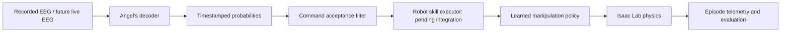

# Isaac Lab project scaffold

This is Mario's simulation architecture, on a separate branch from the earlier
PyBullet prototype. It provides an external Isaac Lab task, reproducible launch
plans, a tested EEG command contract, and measured-outcome aggregation. It is
**scaffolding, not a trained or cloud-validated BCI controller**.

## Architecture



Ground-truth EEG labels belong to the evaluator, not the actor or command
filter. Paired human motion, if adopted after dataset inspection, belongs to a
separate retargeting/demonstration pipeline. It does not establish EEG for novel
robot movements. No dataset or synthetic EEG generator is silently assumed.

## What works locally, and what requires Brev

| Component | Status |
|---|---|
| Offline decoder-export adapter | Implemented; each trial stays a separate episode |
| Confidence/persistence command filter | Implemented; simulator-independent tests |
| Measured episode-outcome summary | Implemented; requires actual telemetry input |
| Cloud command planner and runtime checks | Implemented; default prints plan only |
| Isaac Lab external Franka lift configuration | Implemented against inspected v3.0.0 source; GPU validation pending |
| Training/checkpoint playback | Delegated to upstream RSL-RL runner; cloud smoke pending |
| EEG commands affecting the simulated robot | **Pending**: the skill executor must implement hold/resume and restart semantics |
| Automatic simulator-to-Outcome recorder | **Pending**: implement after inspecting the pinned task's measured termination/reward outputs |
| Research experiment / multi-seed results | Pending; stock task training is the baseline infrastructure |

The boundaries above are deliberate: a command trace is not robot execution,
playback is not a quantitative evaluation, and a successful process exit is not
evidence of a successful grasp.

## Local checks (no Isaac, CUDA, or EEG download required)

From the repository root:

```powershell
python -m pip install -e simulation --no-deps
python -m unittest discover -s simulation/tests -v
python -m fri_bci_sim.cli train --isaaclab-root C:/path/to/IsaacLab --run-dir outputs/isaac/smoke
```

The third command prints an argv list; it does not start training. Pure command
logic supports Python3.12+; the pinned cloud simulator uses Python3.12.

With Angel's existing export:

```powershell
python -m fri_bci_sim.cli replay --predictions outputs/baseline/test_predictions.json --output outputs/isaac/requests.jsonl
```

This is isolated-trial replay with confidence-only acceptance. It cannot measure
command-switch rates, continuous latency or temporal persistence. Each current
prediction has a unique trial ID; never smooth across unrelated trials to invent
a continuous command stream. A future causal rolling-window adapter must emit
repeated estimates for the same episode before persistence can be evaluated.
The example threshold0.7 is a configurable baseline, not a calibrated probability
guarantee. Select thresholds and persistence on training/validation data.

## Robot-learning task

`FRI-Franka-Lift` inherits the pinned upstream Franka scene, contact model,
relative-joint-position actions, robot/object observations, rewards and RSL-RL
PPO configuration. The policy learns low-level actions; this project creates no
fixed cube-to-gripper attachment. Object geometry and robot state are simulation
observations, not predictions inferred from EEG.

The upstream task proposes aligned pre-grasps with probability0.75. We override
that to0 for both training and play, so the baseline is table-only. This makes
learning harder; no performance is promised. Keep the full resolved upstream
configs with results, since upstream curricula and material randomization remain
active during training. Evaluate matched scene seeds and separate seeds for
training/evaluation; different seeds alone are not cross-dataset generalization.

## Command and telemetry contracts

`Estimate` contains only source, episode, window-end/availability timestamps,
and REST/HAND_IMAGERY probabilities. `Request` maps accepted hand imagery to
`grasp_lift`; other cases hold. This is a declared mapping, not a claim that the
dataset contains a distinct grasp-imagery label. The filter rejects future,
stale, duplicate and out-of-order evidence and resets at episode/source changes.

The pending executor must treat HOLD as maintaining appropriate arm/gripper
targets, including an existing grasp. Sending zero joint positions, repeatedly
applying a previous relative action, or opening the fingers is not a validated
hold implementation. It must keep simulator state and decoder time separate,
and log command switches and response times. The current task runs the standalone
manipulation skill without this executor; `launch.json` says `eeg_connected:false`.

The future simulator recorder must produce one JSON object per completed episode:

```json
{"episode":"test-001","requested":"grasp_lift","success":false,"unintended_motion":false,"dropped":false,"duration_s":8.0}
```

Flags must be computed from physical state over a declared evaluation horizon,
not copied from command acceptance or positive reward. Define success using a
lift-height/target tolerance sustained for a fixed dwell, drops after acquisition,
and motion during instructed hold. Specify tolerances before evaluating. The
`requested` behavior is the true evaluation request, not necessarily the decoded
command. Record trial IDs and split/scene provenance separately.

```powershell
python -m fri_bci_sim.cli score --outcomes outputs/isaac/measured_episodes.jsonl
```

Missing classes produce a null balanced score. An always-hold control must not
look good by omitting grasp episodes. Comparisons should include correct
scripted requests, raw predictions, confidence-only and temporal acceptance
(once continuous replay exists), plus always-hold and EEG-shuffled controls.

## Next cloud milestones

1. Follow [cloud runbook](cloud/README.md); confirm external task discovery and a
   short table-only physics/training smoke before a long job.
2. Inspect contact, joint ranges, reset placement and upstream reward telemetry;
   record a short scene demo and implement the measured-outcome recorder.
3. Run initial clean-command skill training, then verify hold/resume behavior
   through a robot executor. Extend observation/reward conditioning if one policy
   is expected to learn both modes. Current task trains the active skill only.
4. Connect actual EEG requests only after those checks. Keep the original command
   filtering question and any newer transfer/generation study separately specified.

## Sources and runtime pin

- Isaac Lab tag `v3.0.0`, source commit
  `e3f7d9ff1f5d7f8280de3ece9000b7117f66bcf4`.
- [Upstream external-project template](https://github.com/isaac-sim/IsaacLab/blob/v3.0.0/tools/template/templates/external/pyproject.toml.jinja)
- [Upstream Franka configuration and reset semantics](https://github.com/isaac-sim/IsaacLab/blob/v3.0.0/source/isaaclab_tasks/isaaclab_tasks/core/lift/config/franka/franka_env_cfg.py)
- [Installation](https://docs.nvidia.com/isaaclab/isaac-lab/installation)
- [Brev Isaac launchable](https://docs.isaacsim.omniverse.nvidia.com/6.0.0/installation/install_advanced_cloud_setup_launchable.html)

Upstream source inspection and local unit tests do not substitute for running
the selected Newton backend and task on the target GPU.
